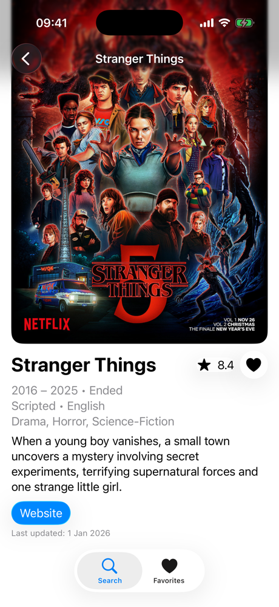
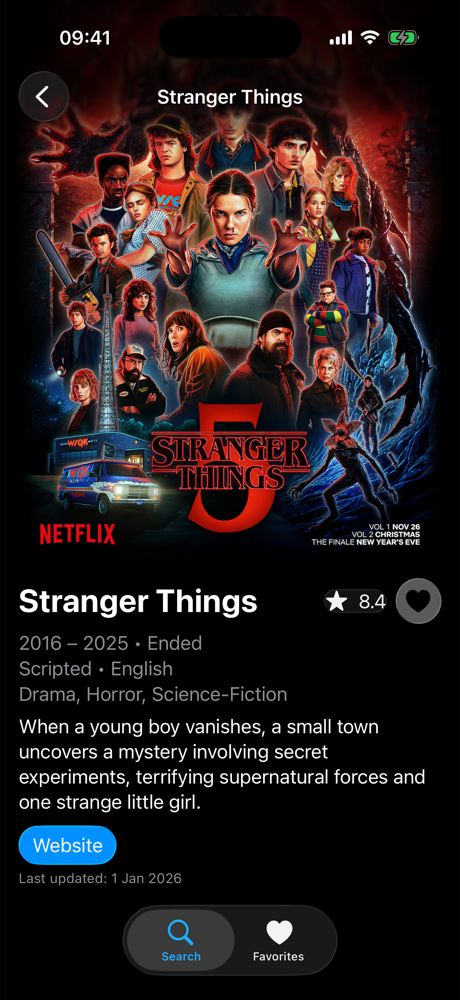

# TVMazeApp

Search TV shows, open their details and keep favorites on device. A native SwiftUI app for iOS 26.5, built on the [TVMaze API](https://www.tvmaze.com/api) with no third-party dependencies.

  
  
  
  

## Features

- Search shows by name and browse the results as poster cards.
- Open a show for its full details and a link to its website.
- Save favorites on device from any card or detail screen, and find them in their own tab.

## Architecture

The app follows the MVVM architecture (Model–View–ViewModel), which splits the code into three roles:

- **Models** are types that hold data, like a show with its name, poster and rating. The app has three kinds, one per layer: networking, domain and persistence models.
- **Views** are what the user sees and taps, like a list of shows or a search bar. In SwiftUI, they update automatically when their data changes.
- **The ViewModel** holds the logic behind a screen, like loading search results or handling an error. It gives the views what to display, and since it has no UI, it can be tested without one.

With SwiftData, simple reads and writes can stay in the views, since SwiftData keeps the screen up to date by itself. Favorites work this way, so they skip the ViewModel.

  

### Views (UI)

- **Screen updates:** when data changes, SwiftUI redraws only the parts that show it. A view that has a ViewModel declares it with `@State`, instead of the older `@StateObject`, so SwiftUI creates it only once.
- **Navigation:** screens open the next one themselves. Tapping a card follows a `NavigationLink` to the detail screen, inside a `NavigationStack`. UIKit apps often needed a separate coordinator object to move between screens.
- **Liquid Glass (iOS 26):** Apple's new see-through design. `glassEffect` gives any view the glass look, and the `.glassProminent` button style makes a button stand out with it.
- **Search:** `.searchable` adds the standard iOS search bar, and `.onSubmit(of: .search)` asks the ViewModel for results when the user presses Search on the keyboard.
- **Tabs (iOS 18):** each tab is declared with the new `Tab` API, instead of the older `.tabItem`.

### ViewModel (logic)

- **Observation (iOS 17):** marking the ViewModel `@Observable` lets the view observe its changes, with no extra code. It replaces the older `ObservableObject` and works with `@State` in the view.
- **Concurrency (Xcode 26):** with the new `MainActor` default isolation, all code runs on the main thread, the one that updates the screen, unless marked otherwise. So the ViewModel needs no `@MainActor`, and the app passes Swift 6's strict concurrency checks.
- **Loading and errors:** the ViewModel tracks loading and errors, so the screen shows a spinner while waiting and an alert when something fails.
- **Transformer:** the API sends raw data, such as dates like "2016-07-15" and summaries with HTML tags. The Transformer turns it into the domain models the screens use: years like "2016 – 2025", a rating like "8.4", the summary as plain text, and a default when a field is missing. When the API changes, the screens don't have to.
- **Dependency injection:** to make the ViewModel testable, it receives its service through a protocol instead of creating it, so tests can pass a fake one, called a mock.

### Networking

- **`async/await`:** the app waits for the API's answer without freezing the screen, instead of using the older completion handlers.
- **`Decodable`:** turns the API's JSON text into networking models automatically. Fields the API sometimes leaves out are optional, so a missing one doesn't cause an error.
- **Typed errors:** API failures use their own error type, so the ViewModel can tell them apart from unexpected ones.
- **DataSession:** a protocol that exists only for tests. In the app the service uses `URLSession`, but for tests we give it a fake session instead. Both follow `DataSession`, so the service accepts either one and is tested without internet.

### Persistence

- **SwiftData (iOS 17):** Apple's tool for saving data on the device, newer than Core Data. Marking a class `@Model` is enough for SwiftData to save it, here the favorites.
- **Reads:** `@Query`, the SwiftData version of Core Data's `@FetchRequest`, loads the favorites into a view and refreshes it by itself whenever one is added or removed.
- **Writes:** views save and delete favorites through the model context, SwiftData's object for changes, which they reach with `@Environment`. For example, the favorite button turns the show on screen into a saved favorite.

## Getting started

Requires Xcode 26.5 or later. Open `TVMazeApp/TVMazeApp.xcodeproj`, run the app with **⌘R** and the tests with **⌘U**.

## Tests

- **Swift Testing:** Apple's testing framework, newer than XCTest. `@Test` marks a test, `#expect` checks a result or an error, and `#require` stops a test early when something it needs is missing.
- **Coverage:** the service, the ViewModel and the Transformer are tested without internet, using mocks.
- **Real API data:** a JSON file recorded from the real API, with one show fully filled and one with every optional field empty or missing, so decoding is checked against what the API really sends.

## License

MIT. See [LICENSE](LICENSE).
