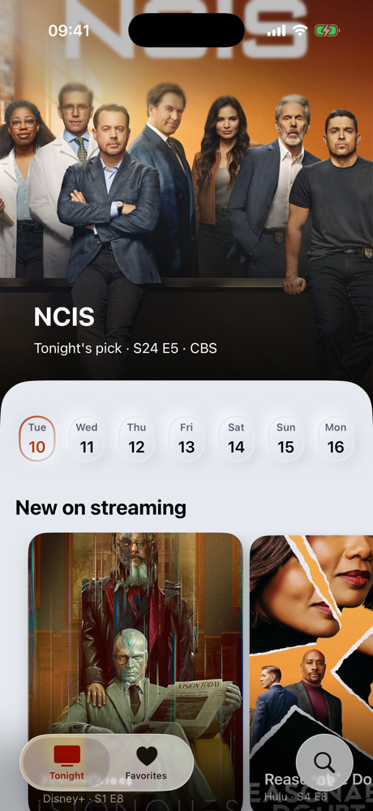
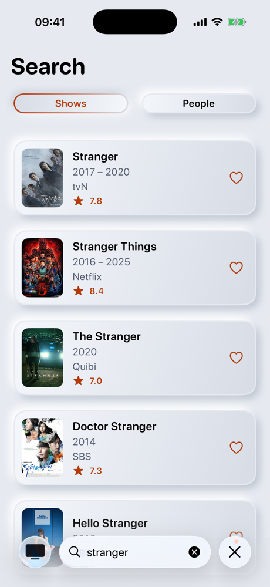
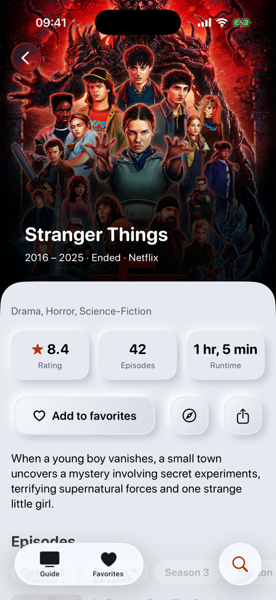
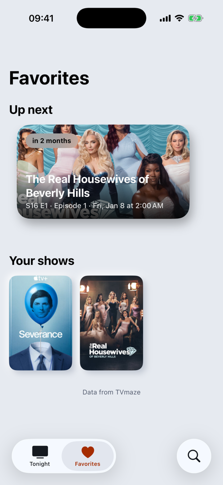
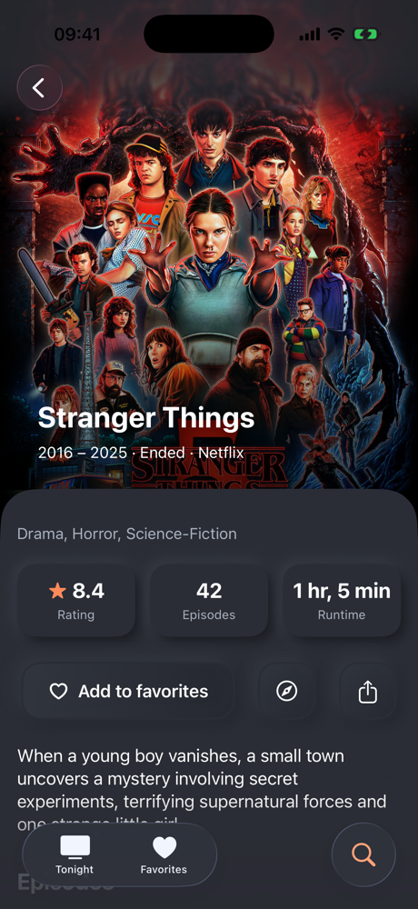

# TVMazeApp

See what's on TV tonight, search shows and people, and keep favorites on device. A native SwiftUI app for iOS 26.5, built on the [TVMaze API](https://www.tvmaze.com/api). Its only dependencies are two design kits of my own, [NeumorphicSwiftUI](https://github.com/A-bv/NeumorphicSwiftUI) and [ParallaxKit](https://github.com/A-bv/ParallaxKit), added as Swift packages.

  
  
  
  
  

## Features

- See tonight's TV listings by time, in their channels' time zone shown as a GMT offset like "GMT-5", with new episodes on streaming and a pick of the night, taken from TV or from streaming when the region has no evening listings, or the same for any of the next six days. The TV listings name their region, which starts on the device's region, or on the US when TVMaze has no listings for it; streaming is the same everywhere.
- Open Settings from the Guide to pick the region of the TV listings among those TVMaze covers, which is kept, to reach the app's language in the Settings app, and to see the app's version and where its data comes from.
- Search shows or people by name and browse the results as soft, raised rows.
- Open a show behind a stretchy hero picture, and browse its episodes by season, its cast, crew, gallery and titles in other countries.
- Open an episode for its guests and crew, and move to the previous or next one in place. The Guide's listings and the Up next cards open their episode directly, with a link to its show.
- Open anyone in the cast or crew to see the shows they're known for, their work behind the camera and their guest appearances.
- Save favorites on device from any search result or show screen. Their tab shows the next episode of each one still airing, soonest first, above the saved shows as a grid of posters or as a list with their year, channel, rating and next air day or status. They can be sorted by date added, next episode, name or rating, and Edit or a long press removes one. Opening the tab also brings the saved shows up to date.
- Reopen without a connection what was already loaded, like the Guide or a show seen before.
- Use the app in English or French.

## Architecture

The app follows the MVVM architecture (Model–View–ViewModel), which splits the code into three roles:

- **Models** are types that hold data, like a show with its name, poster and rating. The app has three kinds, one per layer: networking, domain and persistence models.
- **Views** are what the user sees and taps, like a list of shows or a search bar. In SwiftUI, they update automatically when their data changes.
- **The ViewModel** holds the logic behind a screen, like loading search results or handling an error. It gives the views what to display, and since it has no UI, it can be tested without one.

With SwiftData, simple reads and writes can stay in the views, since SwiftData keeps the screen up to date by itself. Favorites work this way: the hearts and the poster grid read and write SwiftData directly, and only the Up next row, which calls the API, has a ViewModel.

  

### Views (UI)

- **Screen updates:** when data changes, SwiftUI redraws only the parts that show it. A view that has a ViewModel declares it with `@State`, instead of the older `@StateObject`, so SwiftUI creates it only once.
- **Navigation:** screens open the next one themselves. Tapping a result follows a `NavigationLink` to the detail screen, inside a `NavigationStack`. UIKit apps often needed a separate coordinator object to move between screens.
- **Soft Cinema design:** content sits on one soft surface. NeumorphicSwiftUI's button and toggle styles make what can be tapped look raised, and what is selected look pressed in. ParallaxKit's stretchy header and carousel make pictures move as the user scrolls. Text uses SF Pro Rounded, whose soft letters match the soft surfaces, including the navigation titles.
- **Liquid Glass (iOS 26):** Apple's new see-through design. Only what floats above the content uses it, like the back button and the tab bar, which iOS 26 gives the glass look by default, the small labels over pictures and the season picker.
- **Search:** `.searchable` adds the standard iOS search bar, and `.onSubmit(of: .search)` asks the ViewModel for results when the user presses Search on the keyboard.
- **Empty states (iOS 17):** `ContentUnavailableView` shows a message before the first search or when a search fails, and Apple's standard "No Results" view when nothing is found.
- **Accessibility:** VoiceOver labels describe what buttons do and what values mean, and text adapts to the user's chosen size.
- **Localization (Xcode 15):** a String Catalog holds the app's text in English and French, instead of the older `.strings` files.
- **Tabs (iOS 18):** each tab is declared with the new `Tab` API, instead of the older `.tabItem`. The Search tab has the search role, which iOS 26 shows as its own round button beside the tab bar.

### ViewModel (logic)

- **Observation (iOS 17):** marking the ViewModel `@Observable` lets the view observe its changes, with no extra code. It replaces the older `ObservableObject` and works with `@State` in the view.
- **Concurrency (Xcode 26):** with the new `MainActor` default isolation, all code runs on the main thread, the one that updates the screen, unless marked otherwise. So the ViewModel needs no `@MainActor`, and the app passes Swift 6's strict concurrency checks.
- **Loading and errors:** the ViewModel tracks loading and errors, so the screen shows a spinner while waiting and an error message when something fails.
- **Transformer:** the API sends raw data, such as dates like "2016-07-15" and summaries with HTML tags. The Transformer turns it into the domain models the screens use: years like "2016 – 2025", a rating like "8.4", the summary as plain text, and a default when a field is missing. Dates stay dates, so each screen writes them in the user's language and format. When the API changes, the screens don't have to.
- **Dependency injection:** to make the ViewModel testable, its service goes through a protocol, with the real one as the default, so tests can pass a fake one, called a mock.

### Networking

- **`async/await`:** the app waits for the API's answer without freezing the screen, instead of using the older completion handlers.
- **`Decodable`:** turns the API's JSON text into networking models automatically. Fields the API sometimes leaves out are optional, so a missing one doesn't cause an error. Only the fields the app uses are decoded, so changes to the others can't break a search.
- **Typed errors:** API failures use their own error type, so each failure is clear and easy to test.
- **Offline cache:** `URLCache` keeps the API's answers and the pictures on the device. When a request fails because the network is down, the service asks again for the cached answer only, so screens already seen still open.
- **DataSession:** a protocol that exists only for tests. In the app the service uses `URLSession`, but for tests we give it a fake session instead. Both follow `DataSession`, so the service accepts either one and is tested without internet.

### Persistence

- **SwiftData (iOS 17):** Apple's tool for saving data on the device, newer than Core Data. Marking a class `@Model` is enough for SwiftData to save it, here the favorites.
- **Reads:** `@Query`, the SwiftData version of Core Data's `@FetchRequest`, loads the favorites into a view and refreshes it by itself whenever one is added or removed.
- **Writes:** views save and delete favorites through the model context, SwiftData's object for changes, which they reach with `@Environment`. For example, the favorite button turns the show on screen into a saved favorite.

## Getting started

Requires Xcode 26.5 or later. Open `TVMazeApp/TVMazeApp.xcodeproj`, run the app with **⌘R** and the tests with **⌘U**.

## Tests

- **Swift Testing:** Apple's testing framework, newer than XCTest. `@Test` marks a test, `#expect` checks a result or an error, and `#require` stops a test early when something it needs is missing.
- **Coverage:** the service, the ViewModel and the Transformer are tested with mocks, and the saved favorites with an in-memory database, all without internet.
- **UI tests:** `XCUIAutomation` drives the real app through the Guide, search and favorites using the live API, and `performAccessibilityAudit` checks the results screen, apart from what sits under the floating search bar. They're written in XCTest because Swift Testing doesn't support UI tests.
- **Real API data:** a JSON file recorded from the real API, with one show fully filled and one with every optional field empty or missing, so decoding is checked against what the API really sends.

## License

MIT. See [LICENSE](LICENSE).
